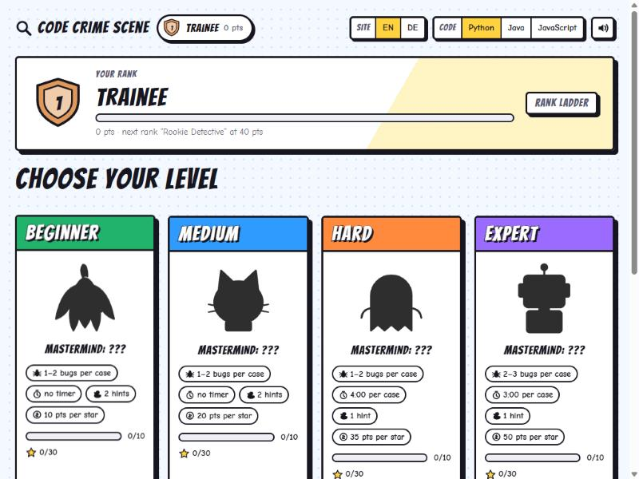

# Code Crime Scene · Code-Tatort

**Ein Comic-Detektivspiel zum Debuggen lernen.** In Code City spielen Programme verrückt. Du stellst
jeden Tatort Zeile für Zeile nach, überführst die schuldige Zeile mit der Lupe und reparierst sie.

*A comic-detective debugging game: 50 coding crime scenes in Python, Java and JavaScript, from Beginner to IMPOSSIBLE.*

**▶ Spielen:** https://muhamedkastrati.github.io/code-crime-scene/



## So läuft ein Fall

1. **Zeugenaussage lesen:** Was hätte passieren sollen, und was ist passiert?
2. **Nachstellen:** Das Programm läuft Schritt für Schritt. Notizzettel zeigen jede Variable, Sprechblasen jede Bedingung.
3. **Lupe:** Klick auf die Zeile, die du für schuldig hältst. Falscher Verdacht kostet einen Stern.
4. **Reparieren:** Von drei Reparaturen ist genau eine richtig. Die falschen erklären, warum sie scheitern.

## Fünf Stufen, fünf Drahtzieher

| Stufe | Bugs pro Fall | Zeitlimit | Tipps | Punkte pro Stern | Drahtzieher |
|---|---|---|---|---|---|
| Beginner | 1–2 | – | 2 | 10 | Die Schussel-Schale |
| Medium | 1–2 | – | 2 | 20 | Die Kopierkatze |
| Hard | 1–2 | 4:00 | 1 | 35 | Niemand |
| Expert | 2–3 | 3:00 | 1 | 50 | Das Erbstück |
| IMPOSSIBLE | 2–3 | 2:00 | 0 | 80 | Die Deadline |

Jede Stufe hat 10 Fälle. Jeder gelöste Fall reißt ein Stück vom Fahndungsplakat, das Finale enttarnt den
Drahtzieher. Bei IMPOSSIBLE bleiben die Werte auf den Notizzetteln geheim.

Die Bugs werden mit jeder Stufe gemeiner: Eins-daneben-Fehler, `=` statt Kopie bei Listen,
`0.1 + 0.2 != 0.3`, Zahlen als Text sortiert, Endlosschleifen, Abstürze durch `None`/`null`,
Rekursion ohne Abbruch, Operator-Reihenfolge, Bubblesort mit kaputtem Tausch …

## Ränge

Sterne bringen Punkte (je schwerer die Stufe, desto mehr). 11 Ränge von **Azubi** bis **Bug-Orakel**,
mit Abzeichen von Bronze bis Regenbogen und einer Aufstiegs-Animation. Maximal 5850 Punkte.

## Sprachen

- Code: **Python, Java, JavaScript**, jederzeit umschaltbar
- Seite: **Englisch** (Standard) und **Deutsch**
- Der Fortschritt bleibt im Browser gespeichert (`localStorage`).

## Aufbau

Das Spiel ist eine einzige HTML-Seite ohne Server und ohne Abhängigkeiten.

```
src/style.css        Comic-Look (Panels, Animationen)
src/js/              Zustand & Texte, Zeichnungen, Bösewichte, Syntaxfarben, Sound, Engine
src/cases/           die 50 Fälle (je Stufe eine Datei)
tools/build.js       baut alles zu index.html zusammen
tests/               Prüfungen für alle Fälle
```

Jeder Fall enthält den Code in allen drei Sprachen, die Reparaturen und eine Funktion `sim(F, lang)`,
die den Ablauf für eine Menge reparierter Bugs `F` Schritt für Schritt beschreibt.

```bash
npm run build      # index.html neu bauen
npm test           # Datenprüfung: erwartete Ausgabe, keine Teil-Reparatur passt zufällig
npm run test:real  # führt jeden Fall in Python, Java und JavaScript wirklich aus
```

`test:real` startet jede Kombination aus reparierten Bugs (166 Programme pro Sprache) und vergleicht die
echte Ausgabe – inklusive Abstürzen und Endlosschleifen – mit dem, was das Spiel anzeigt. Dafür müssen
`python` und `java` (ab JDK 11) installiert sein; ein anderes Java mit `JAVA=/pfad/zu/java`.

## Lizenz

MIT
